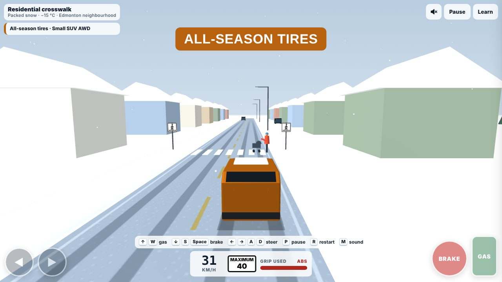
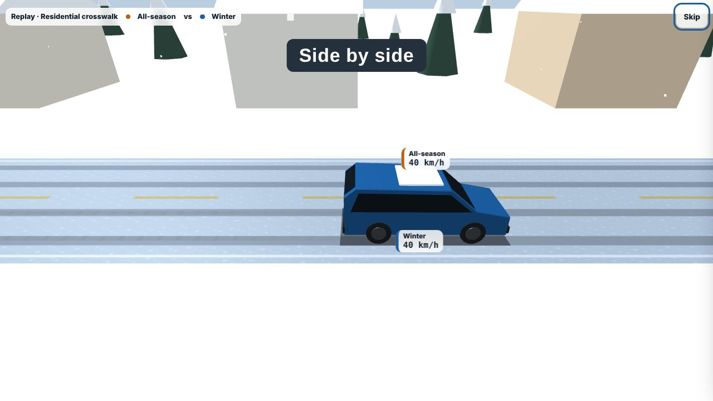
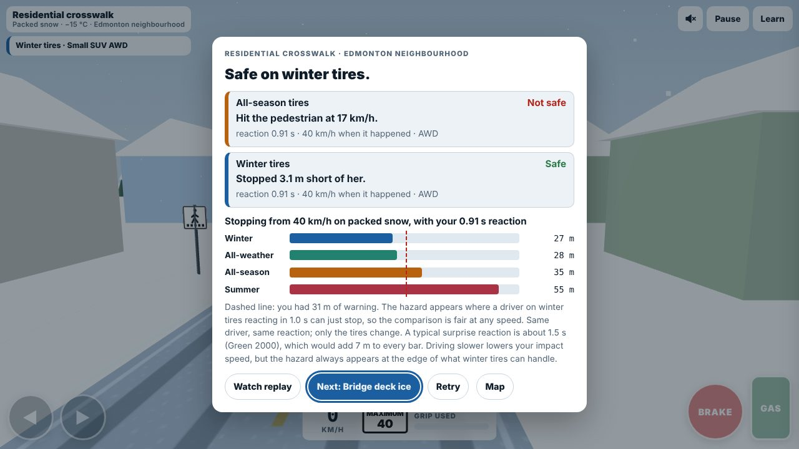
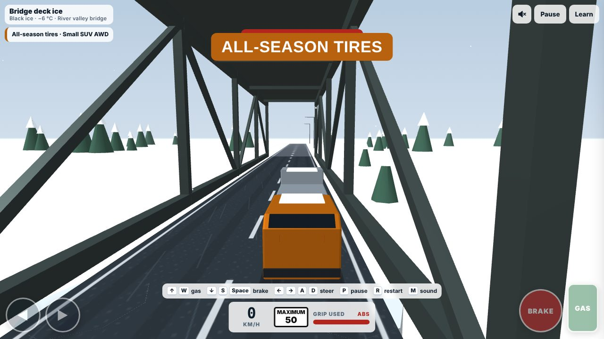
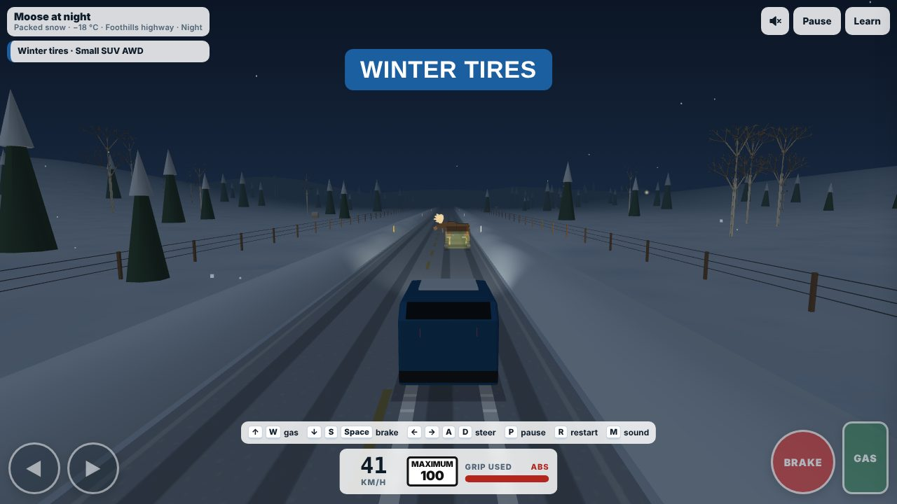
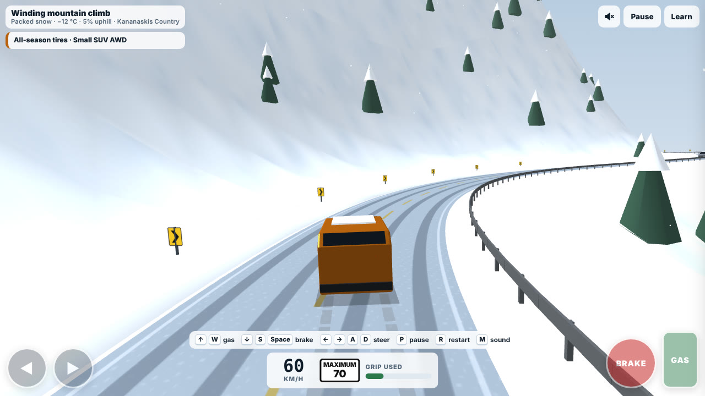
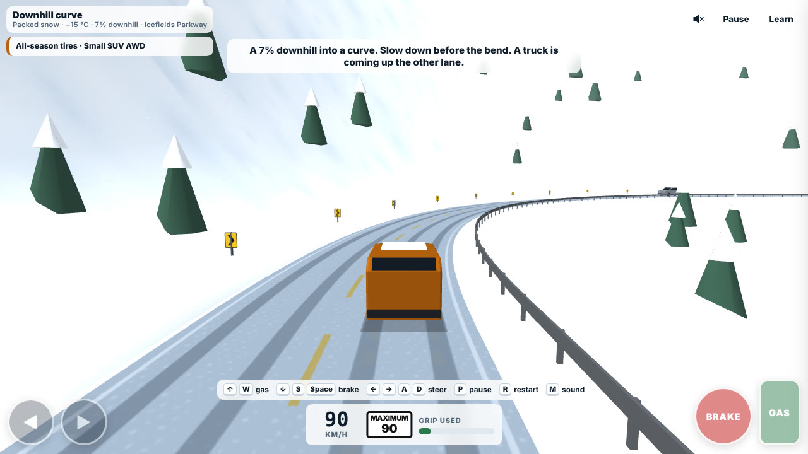
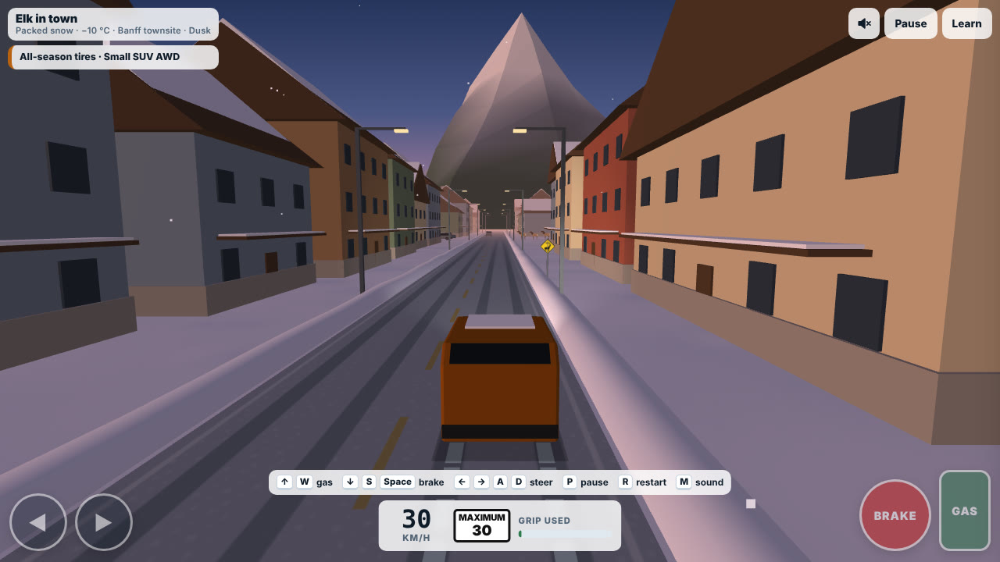

# Alberta Winter Tire Challenge

A free 3D driving game about winter tires in Alberta. You drive fourteen real Alberta winter situations on the tires you have now, then drive the same ones again on winter tires and compare.

**Play it:** open `index.html` in a browser, or use the GitHub Pages link once Pages is turned on for this repo.

| | |
|---|---|
|  |  |
|  |  |
|  |  |
|  | |

Video: [media/winter-tire-challenge.mp4](media/winter-tire-challenge.mp4): a crosswalk, a bridge deck and a moose at night, each on all-season and then winter tires.

## The situations

| Where | Situation | Surface |
|---|---|---|
| Edmonton | Residential crosswalk, 40 km/h | Packed snow, −15 °C |
| Edmonton | Bridge deck ice (inspired by the High Level Bridge) | Dry approach, black ice on the deck, −6 °C |
| Edmonton | Downtown intersection (inspired by Jasper Avenue) | Dry road, polished ice at the intersection, −3 °C |
| Edmonton | Icy hill start, 6% (river valley) | Polished ice, −8 °C |
| Edmonton | Freeway on-ramp curve (inspired by Whitemud Drive) | Packed snow, −10 °C |
| Edmonton | Ice under the overpass (inspired by Anthony Henday Drive) | Dry freeway, black ice in the shade of the bridge |
| Calgary | Black ice at 100 km/h at night (inspired by Stoney Trail) | Black ice, −8 °C |
| Rural Alberta | Gravel range road with a deer at dusk | Snowy gravel (estimate), −12 °C |
| Foothills | Moose at night, 100 km/h | Packed snow, −18 °C |
| Highway 2 | Freezing rain, the car ahead spins out (inspired by the QEII) | Glaze ice, −1 °C (estimate) |
| Kananaskis | Winding climb (inspired by Highway 40) | Packed snow, 5% uphill |
| Icefields Parkway | Downhill curve | Packed snow, 7% downhill, −15 °C |
| Crowsnest Pass | Crash ahead on Highway 3, stopped traffic | Packed snow, 6% downhill |
| Banff | Elk in town at dusk | Packed snow, −10 °C |

Every situation runs on any of 7 vehicle types, with FWD, RWD, AWD or 4x4, and on winter, all-weather, all-season or summer tires.

Before each drive you can also choose the weather (clear, light snow, blowing snow, freezing rain), the time of day (day, dusk, night), tread wear (new, half worn, near the limit) and ABS on or off. ABS off shows why the old advice to never slam the brakes on an icy bridge made sense for older cars, and why with ABS you brake hard and steer.

## The law in Alberta

Alberta has no province-wide winter tire law. On the Icefields Parkway (Highway 93 North), Parks Canada requires winter-rated tires (M+S or the snowflake symbol) or chains from November 1 to late March. M+S all-seasons count as legal there, but the M+S marking has no snow or ice test behind it. Legal isn't the same as safe. Elsewhere, Québec requires winter tires with the snowflake symbol from December 1 to March 15, and BC requires winter-rated tires on many highways from October 1.

## Controls

| Key | Action |
|---|---|
| ↑ or W | Gas |
| ↓, S or Space | Brake |
| ← → or A D | Steer (tap, don't hold) |
| P or Esc | Pause |
| M | Sound on/off |
| R | Restart |

On a phone, use the on-screen ◀ ▶, BRAKE and GAS buttons, with the phone held sideways.

## How the physics works

- **Grip (μ) per tire and surface.** Packed snow and ice values come from braking distances in Tire Rack's 2026 all-weather vs. winter test (μ = v² ÷ 2gd). Other surfaces are estimates that keep the tested ratios between tires. The full table is in the game's Learn menu.
- **Temperature.** Ice is slipperiest near 0 °C (Tada et al., *Friction*, 2023). Snow grips better as it gets colder.
- **Friction circle.** Braking, steering and accelerating share one grip budget. ABS keeps steering available. On loose gravel, ABS stops about 27% longer (NHTSA).
- **Hills.** Deceleration = g(μ cos θ + sin θ), the exact form of the AASHTO stopping-distance formula.
- **Drive type.** Pulling force is limited by the weight on the driven wheels. Braking and cornering are the same for every drive type (UMTRI 2016, Consumer Reports).
- **Hazards** appear where a driver on winter tires reacting in 1.0 s stops 2.5 m short, so the comparison between tires is fair at any speed.
- **ABS off.** Locked wheels slide at a fraction of peak grip (lower on ice and pavement, slightly higher on loose snow and gravel) and can't steer. Estimates, informed by NHTSA and VTI ABS testing.
- **Weather.** Freezing rain turns every surface into glaze ice near 0 °C (an estimate). Light snow covers bare pavement. Blowing snow cuts visibility.

All sources are listed in the game under Learn → Sources.

## Honest limits

This is an educational physics model, not a guarantee of how any tire, car or road will behave. Places are stylized look-alikes. Snowy gravel grip is an estimate, because no published study has measured it. Glaze-ice grip and locked-wheel grip are also estimates. Crash statistics show smaller gains (about 5–6% fewer claims or victims) than braking tests do, because most winter days aren't icy.

An independent project. Not sponsored or endorsed by any government, tire company, retailer or insurer. Organizations are cited as sources only. Made by an Alberta driver in Edmonton.
